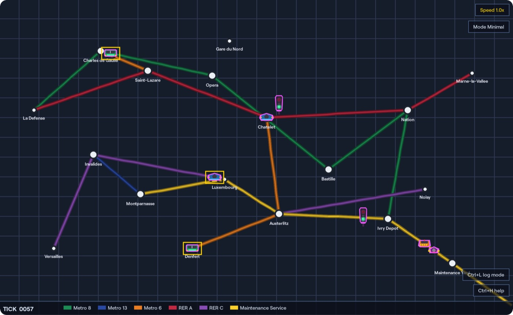

<!--suppress HtmlDeprecatedAttribute -->
<div align="center">
   <p align="center">
      <br>
      <a href="docs/assets/images/branding/metrogym-homepage-cover.jpg">
         
      </a>
   </p>
   <h4 align="center">
      A pure Python pygame MetroGYM teaching library for metro-network simulation and control logic —
      <a href="https://metrogym.readthedocs.io/">Documentation</a> ·
      <a href="https://github.com/larrywhizz767-png/MetroGYM">GitHub</a> ·
      <a href="https://pypi.org/project/metrogym/">PyPi Index</a>
   </h4>
</div>

<div align="center">

<a href="https://github.com/larrywhizz767-png/MetroGYM">
   
</a>


</div>

## <a id="about-the-project"></a> About The Project

`MetroGYM` is a pure Python, pygame-powered teaching library for metro-network simulation, signalling, and control logic. It is intentionally small and inspectable: you build a network from primitives, attach train and signal agents, then run it visually or headlessly.

MetroGYM allows you to build complex metro systems from explicit primitives, then drive those worlds with typed train and signal solvers. It's designed for educational purposes, providing a clear and interactive way to understand transport network dynamics and algorithmic control.

[See more in the documentation.](https://metrogym.readthedocs.io/)

## <a id="installation"></a> Installation

> [!WARNING]
> **Pip is incoming!** MetroGYM is currently in early development and not yet available on PyPi.

### Prerequisites

Before you begin, ensure you have the following installed on your system:

- **Git**: For cloning the repository.
- **uv**: The recommended Python package and project manager. Install it via [astral.sh/uv](https://astral.sh/uv).

### Install From Source

1. **Clone the repository:**
   ```bash
   git clone https://github.com/larrywhizz767-png/MetroGYM.git
   cd MetroGYM
   ```

2. **Sync the environment:**
   `uv` will automatically create a virtual environment, install the correct Python version, and fetch all dependencies (including `pygame` and `beartype`).
   ```bash
   uv sync
   ```

3. **Verify the installation:**
   Run a quick check to ensure everything is set up correctly:
   ```bash
   uv run python -m compileall src
   ```

## <a id="getting-started"></a> Getting Started

To build your first simulation, you define the world through a pipeline of explicit primitives:

1. **Initialise the System**: Create a `MetroSystem` to manage the lifecycle and rendering.
2. **Define the Infrastructure**: Use a `Network` to group your `Line` paths and `Station` locations.
3. **Attach Agents**: Add a `Train` with a specific `solver` (the agent's brain) and a `Signal` that controls access to specific track segments.
4. **Build and Run**: Call `.fit()` to validate the topology and `.run()` to start the interactive simulation.

```python
from metrogym import Color, MetroSystem, signal, train
from metrogym.primitives import ControlRule, Line, Network, Signal, Station, Train

system = MetroSystem(name="Quick Start", render_scale=2).pipeline([
    Network([
        Line("Loop", Color.BLUE, [(120, 120), (560, 120), (560, 360), (120, 360), (120, 120)]),
        Station("West", (120, 120)),
        Station("North", (560, 120)),
        Station("South", (560, 360)),
    ]),
    Train("A", line="Loop", solver=train.always_proceed(), asset="metro_nose"),
    Signal(
        "North Gate",
        (560, 85),
        controls=ControlRule("Loop", (560, 120), (560, 360)),
        solver=signal.pulse(green_ticks=5, red_ticks=3),
    ),
])

system.fit().run()
```

## <a id="local-documentation"></a> Local Documentation

To run the documentation locally, ensure you have the `docs` dependencies installed and run:

```bash
uv sync --group docs
uv run zensical serve
```

## <a id="license"></a> License

MetroGYM is licensed under the [MIT License](https://opensource.org/licenses/MIT).
